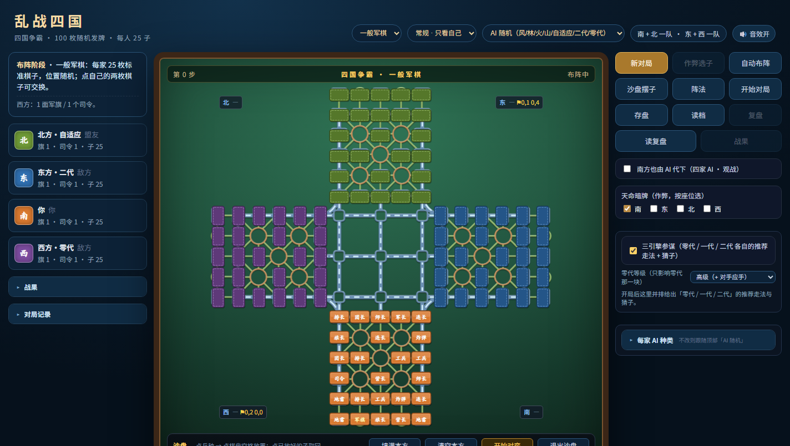

# 四国争霸 · 四国军棋 AI

浏览器里直接跑的四国军棋，带四代 AI 引擎、暗子猜子面板、复盘与沙盘推演。
纯前端、零依赖、无构建——**双击 `index.html` 就能玩**。



## 试玩

- 在线：`https://guiren684.github.io/junqi-chaos/`（启用 GitHub Pages 后；仓库名不同就替换）
- 本地：直接双击 `index.html`；或 `python -m http.server 8000` 后访问 `http://localhost:8000`

## 四代 AI

| 代 | 文件 | 说明 | 相对强度 |
|---|---|---|---|
| 零代 | `ai_gen0.js` | 逆向还原的早期引擎，规则+启发式，无搜索 | 基准 |
| **一代** | `ai.js` | 主力引擎：PIMC 暗子抽样 + 选择性 Alpha-Beta + 信念后验 + 战术层 | 最强 |
| 二代 | `bc_ai.js` | 人类对局行为克隆（小型卷积网络，纯 JS 前向）+ 1 层浅搜索 | 对一代约 28% |
| 三代/风格 | `ai.js` 内 `PROFILES` | 风/林/火/山四种风格 + 自适应世界数与深度 | — |

**一代的核心不是算力，是信息**：暗子猜子（12 类分布，top1 约 37%）+
阵型库联合后验（11,042 座人类阵型）+ 吃子似然表。
实测「天眼」（直接看到全部子力）胜率 92.4%，常规约 50% —— **信息值 42 个百分点**。

## 功能

- 四国军棋完整规则（标准 / 乱战两种模式，军旗升起、行营、铁路、炸弹与地雷判定）
- 玩家执一方，其余三家 AI；支持「南方也由 AI 代下」观战
- **猜子面板**：每枚暗子的档位概率（大/旅/小/雷/旗/炸）+ 证据账（锁/吃/区/位/阵）
- **参谋**：显示 AI 自己的候选打分（局面分、风险、先验、战术项）
- 复盘：逐帧回放、跳转、导出 JSON
- 沙盘/接管：随时改变局面推向

## 目录

```
index.html            入口（20 个 <script>，无打包）
board.js              棋盘与坐标模型
game.js               规则与状态机
ai.js                 一代引擎（搜索 / 信念 / 战术）
tactics.js            战术层（双急所：两路攻旗、双威胁、预备态）
ai_gen0.js            零代引擎
bc_ai.js              二代（行为克隆）引擎
bc_model_data.js      二代权重（26 MB，页面加载时会下载）
formations*.js        阵型数据（人类阵型库、乱战阵型）
*_data.js             统计表（吃子似然、阵型联合后验、区域条件概率）
ui.js                 界面与交互
style.css             样式
assets/ sounds/       底图、截图、音效
介绍.html              项目说明页（带截图）
怎么玩.txt             上手指引
```

## 已知限制

- **二代很慢**：`bc_model_data.js` 26 MB，首次加载需下载完整权重。
- **双人对局（1v1）已封印**：AI 的协同/威胁模型按四人写死（`ALLY_OF` 为静态映射），
  1v1 下会把对手当队友，表现是「既不进攻也不防守」。代码与测试保留，等做 1v1 引擎时再解封。
- 猜子是**概率**不是真值：面板显示档位而不是具体军衔（12 类各 10% 的分布里写「连长 14%」是噪声）。

## 第三方与许可

- 搜索架构与棋盘模型改编自 [BitByBitG/siguo-junqi](https://github.com/BitByBitG/siguo-junqi)（MIT）。
  完整声明见 [THIRD_PARTY_NOTICES.md](THIRD_PARTY_NOTICES.md)。
- 本项目代码：[MIT](LICENSE)。
