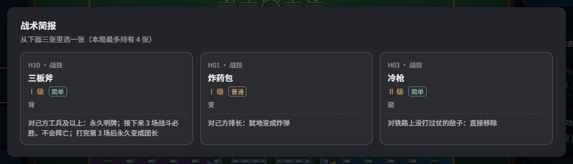

# 四国争霸 2.1 · DLC 版

浏览器里直接跑的四国军棋，带四代 AI 引擎，外加一层 **137 张战术卡**。
纯前端、零依赖、无构建 —— **双击 `index.html` 就能玩**。



## 试玩

- **在线**：<https://guiren684.github.io/junqi-chaos/>
- **本地**：双击 `index.html`，或 `python -m http.server 8000` 后访问 `http://localhost:8000`
- **先看简介**：[`简介.html`](简介.html)（卡怎么用、哪些最好玩）｜**规则详解**：[`介绍.html`](介绍.html)

## DLC 是什么

在四国军棋上加了一层一次性手段：把排长变炸弹、让敌方炸弹哑火两回合、
往敌方行营塞一枚钉子、让一枚子三场战斗必胜……

- **底子不变**：一般军棋（标准 25 子）/ 乱战四国，规则、结算、AI 都是原版，卡是外挂的一层。
- **卡不白给**：每张要挑时机、挑目标，能不能打出效果取决于你看不看得懂局面。
- **单机可玩**：另外三家由本地 AI 接手，不需要联网、不需要注册。

### 三步开始

1. 双击 `index.html`（Chrome / Edge 最佳）。
2. 左上选玩法与座位 →「自动布阵」→「开始对局」。
3. 控制区的 **DLC 默认已勾上**；不想要卡就取消勾选，回到纯军棋。

三选一时机：开局、全局第 50 步、第 100 步、每次扛旗。手牌上限 4 张。

### 卡怎么用

| 规则 | 说明 |
|---|---|
| 只在自己回合 | 轮到别人时点卡不生效，日志会写原因 |
| 被动卡点一下 | 没有目标，点完立即生效 |
| 主动卡：先答题，再选目标 | 答 2 道题定级 → 合法目标亮绿格 → 点绿格生效（无目标的卡答完直接生效） |

- 多目标卡要收满 2–3 个（提示里显示 `1/3`）。
- 「潜伏 / 换位 / 渗透」要选两次：先选自己的子，再选落点或对手。
- 选错：再点已选格子可取消；`Esc` 或再点一次卡片可放弃整套。
- 卡生效后立刻回到正常对局。

### 答题定级（新）

主动卡打出前先答 **2 道题**，题目来自《抗美援朝的英雄事迹》题库（200 题，三选一）：

- 起步 = 手牌等级；**每答对 1 题升 1 级，封顶 Ⅲ 级**（Ⅰ 级卡全对 = Ⅲ 级效果，Ⅱ 级卡答对 1 题就满）。
- **答错不扣牌**，效果照常打出，只是等级低一档；答完立刻给正确答案、英雄名与依据章节。
- 按 `Esc` 或点「不用这张卡」= 放弃，卡不被消耗。
- 被动卡（抽到即生效）不答题；Ⅲ 级卡已满级也不答题；控制区取消「答题定级」可关闭；DEV 下自动跳过。

题库是构建期从 Markdown 生成的：`node tools/build_quiz.js` → `dlc_quiz_data.js`。

### AI 拿满级牌

三个 AI 座位**发牌即 Ⅲ 级**（AI 不会答题，不能因此比人弱一档）；人类仍是从手牌等级起步、答对往上加。

同时把 **137 张卡的 Ⅲ 级整体加强**了一遍：换机制、去掉随机与代价、作用域扩到全体。例如：
炸药包在自家空地直接生成 2 个炸弹、冷枪不再要求「铁路 / 没打过仗」、缴枪不杀能夺司令、
三板斧打完不降级反而 +1 级、撒豆成兵每回合空降 2 枚师长/军长且持续到本局结束、乌龟阵 5 枚后两排全变雷。

加强数据集中在 `dlc_cards_up3.js`（只覆盖 Ⅲ 级，Ⅰ/Ⅱ 级不动）——不加载这个文件就回到旧数值，方便回退。


### 卡池

137 张，七卷：战技 26 / 孙子 13 / 三十六计 29 / 典故 24 / 棋理 23 / 奇想 10 / 简术 12。
其中 125 张主动、12 张被动；按操作复杂度分 **简单 54 / 普通 58 / 复杂 25**，每张有 Ⅰ / Ⅱ / Ⅲ 三级。

想先认识几张招牌卡：见 [`简介.html`](简介.html) 的「**最好玩的一批：12 张招牌卡**」——
三板斧、缴枪不杀、潜伏、夜战、假司令、空城计、炸药包、乌龟阵、瞒天过海、七擒七纵、借兵等，
每张都写了 Ⅰ 级实际效果、怎么打、坑在哪，另附四条连招。

### 军功与记录

吃子、扛旗、零伤亡会攒军功：**30 军功** = 三选一重抽一次（单局上限 2 次）；**40 军功** = 一张卡升一级。

左侧日志会记下打出的卡，例如：

```
【战术】南方 打出「炸药包」Ⅱ → 自己的一枚子@南方4-3
【战术·被动】西方 获得「空炸」Ⅰ（持有即生效）
```

战报里另有一块「战术卡」，按座位列出用过的卡与次数；复盘与存档都带这份记录。

### 调试：开发者模式

按 `F2`（或勾控制区的 **DEV**）打开右下角卡池面板，点任意卡直接**加入手牌**。
面板可按卷/难度筛选、搜卡名或效果、切 Ⅰ/Ⅱ/Ⅲ 级、切座位（给 AI 挂效果）、查看与清空持续状态、↶ 回滚。
DEV 只负责发牌，不改棋盘规则——棋子照常走、照常吃。

## 四代 AI

| 代 | 文件 | 说明 | 相对强度 |
|---|---|---|---|
| 零代 | `ai_gen0.js` | 逆向还原的早期引擎，规则+启发式，无搜索 | 基准 |
| **一代** | `ai.js` | 主力引擎：PIMC 暗子抽样 + 选择性 Alpha-Beta + 信念后验 + 战术层 | 最强 |
| 二代 | `bc_ai.js` | 人类对局行为克隆（小型卷积网络，纯 JS 前向）+ 1 层浅搜索 | 对一代约 28% |
| 三代/风格 | `ai.js` 内 `PROFILES` | 风/林/火/山四种风格 + 自适应世界数与深度 | — |

**一代的核心不是算力，是信息**：暗子猜子（12 类分布，top1 约 37%）+
阵型库联合后验（11,042 座人类阵型）+ 吃子似然表。
实测「天眼」（直接看到全部子力）胜率 92.4%，常规约 50% —— **信息值 42 个百分点**。

界面另有：猜子面板（档位概率 + 证据账：锁/吃/区/位/阵）、三引擎参谋（三家推荐并排，谁也不替你落子）、
逐帧复盘、沙盘推演与接管。

## 目录

```
index.html            入口（20+ <script>，无打包）
board.js              棋盘与坐标模型
game.js               规则与状态机（战斗处留了一个 DLC 钩子）
ai.js                 一代引擎（搜索 / 信念 / 战术）
tactics.js            战术层（双急所：两路攻旗、双威胁、预备态）
ai_gen0.js            零代引擎
bc_ai.js              二代（行为克隆）引擎
bc_model_data.js      二代权重（26 MB，页面加载时会下载）
formations*.js        阵型数据（人类阵型库、乱战阵型）
*_data.js             统计表（吃子似然、阵型联合后验、区域条件概率）
dlc_status.js         持续状态（tick / 到期 / 查询）
dlc_atoms.js          DLC 原子层（45 个单字段动作 + 战斗接管）
dlc_cards.js          卡库（137 张，数据驱动）
dlc_cards_up3.js      Ⅲ 级加强覆盖（只改 Ⅲ 级，可整块关掉）
dlc.js                卡牌引擎（选目标 / 结算 / AI 评分 / 文案 / 记录）
dlc_quiz_data.js      题库数据（200 题，由 tools/build_quiz.js 生成）
dlc_quiz.js           答题定级（抽题 / 判分 / 等级换算）
ui.js                 界面与交互
style.css             样式
assets/ sounds/       底图、说明页截图、音效
简介.html             DLC 简介（推荐先看）
介绍.html             规则与界面详解（带截图）
怎么玩.txt             上手指引
```

## 构建与发布

源码即站点，没有打包步骤；`tools/make_release.js` 只负责挑出「真正被引用到的文件」做一个离线包。

```bash
node tools/build_quiz.js                                      # 题库 md → dlc_quiz_data.js
node tools/quiz_selftest.js                                   # 答题逻辑 + 等级覆盖自测
node tools/quiz_e2e.js                                        # 真浏览器走一遍答题流程
node tools/make_release.js 四国争霸2.1DLC版本 --dlc --clean   # 生成离线包（DLC 默认开）
node tools/publish.js "更新说明"                              # 构建 + 提交 + 推到 GitHub
```

## 已知限制

- **二代很慢**：`bc_model_data.js` 26 MB，首次加载需下载完整权重。
- **双人对局（1v1）已封印**：AI 的协同/威胁模型按四人写死（`ALLY_OF` 为静态映射），
  1v1 下会把对手当队友，表现是「既不进攻也不防守」。代码与测试保留。
- 猜子是**概率**不是真值：面板显示档位而不是具体军衔。
- DLC 里有 7 张是**近似实现**：效果方向对，但少一层路径/条件约束；卡面写的是实际效果，不是设计稿。

## 第三方与许可

- 搜索架构与棋盘模型改编自 [BitByBitG/siguo-junqi](https://github.com/BitByBitG/siguo-junqi)（MIT）。
  完整声明见 [THIRD_PARTY_NOTICES.md](THIRD_PARTY_NOTICES.md)。
- 本项目代码：[MIT](LICENSE)。
